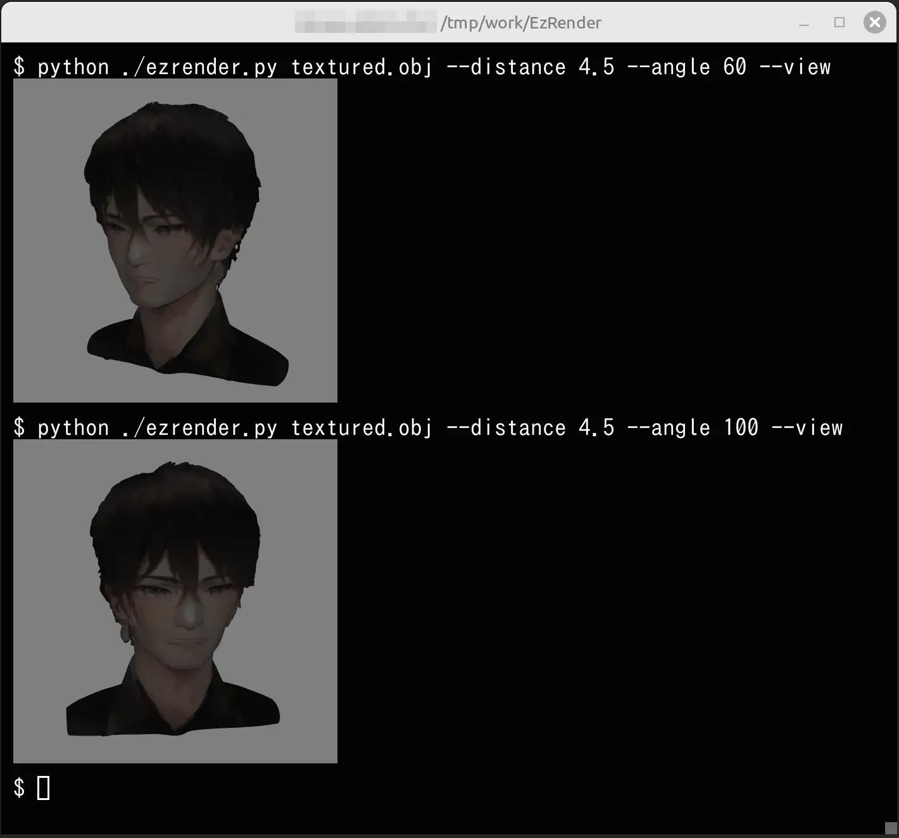

# EzRender

`EzRender` は、`.glb`，`.obj`，`.ply` メッシュおよび3DGS `.ply` 形式の 3D モデルをコマンドラインからレンダリングし、静止画像として保存・表示できる Python スクリプトです。

`timg` を使用してターミナル内で画像を表示できるため、簡易的な確認に便利です。



---

## 特長

- `.obj` / `.glb` に対応
- PLYメッシュに対応（trimesh経由）
- `--3dgs` 指定時に3D Gaussian Splatting `.ply` に対応（OpenGL/EGL，静止画）
- カメラ位置の指定が可能：
  - 極座標（距離と角度）
  - 直交座標（x, y, z）
- WebP 形式での画像保存
- `timg` を使用したターミナル内での即時プレビュー表示（mlterm や ezterm などの Sixel 対応端末が必要）
- 出力画像サイズの指定（デフォルト：512x512）
- ヘッドレス環境での GPU レンダリングが可能（EGL 使用）
- モデル情報のみを表示して終了する機能（`--info` オプション，レンダリングなし）
  -  注意： Color Attribution 情報はテキトウです（...もっとよく勉強してから直す予定）  

## ファイル説明
- ezrender.py ... 3Dデータをターミナルに表示・保存するプログラム
- おまけ(→ utils内のプログラム)
  - srgb2linobj.py... SRGB頂点カラーOBJ → LiearRGB頂点カラーOBJ
  - e3d_objfix.py ... [Era3D](https://github.com/pengHTYX/Era3D) のinstant-nsr-pl で出力されるrefine_###.objを修復してアーティファクトが発生しないようにするツール（アーティファクトの原因を調べるが大変でした・・・）
  - tkg_era3d_fullauto.py ... [Era3D](https://github.com/pengHTYX/Era3D) を簡単に実行するためのスクリプト（Era3DはConda環境で作成していることを想定）．
  - vc2texobj.py ... 頂点カラーOBJをUVテクスチャOBJにする（pymeshlabで，UV展開・頂点カラーをテクスチャにベイク）．
  - vc2glb.py    ... 頂点カラーOBJをGLBにする（pyxatlasでスマートUV展開して，pymeshlabで頂点カラーをベイク）．
---

## インストール

Linux（Ubuntu/Debian系）の例です．Python 3.10以降を推奨します．普段使いには`pipx`を推奨します．開発時には従来の`venv`も利用できます．

### 推奨：pipxでコマンドとしてインストール

`pipx`はEzRender専用の仮想環境を自動作成し，`ezrender`コマンドをPATHに公開します．リポジトリのcloneや`source .venv/bin/activate`は不要です．Pythonパッケージをシステム環境に直接インストールしません．

```bash
sudo apt update
sudo apt install pipx libegl1 libgl1 timg
pipx ensurepath
pipx install git+https://github.com/takago/EzRender.git
```

`pipx ensurepath`の後，PATHへの変更が反映されないときはターミナルを開き直してください．`timg`はターミナル内プレビュー用の任意依存です．`--no-view`で画像を保存するだけなら不要です．3DGSやメッシュの描画にはEGL対応のOpenGL環境が必要です．

インストール後は任意のディレクトリから実行できます．

```bash
# GLBを4方向から表示
ezrender model.glb

# 3DGSを4方向から表示
ezrender model.ply --3dgs

# 角度を指定してWebP保存
ezrender model.ply --3dgs --yaw 45 --pitch 20 --output view.webp --no-view

# レンダリングせずにモデル情報を確認
ezrender model.ply --3dgs --info
```

更新・削除は次のとおりです．

```bash
pipx upgrade ezrender
pipx uninstall ezrender
```

補足：`pipx upgrade ezrender`はインストール元のGitリポジトリを使用して更新します．開発中のローカル変更を試す場合は，下記の`venv`を使ってください．

### 開発用：Python venvで実行


#### 1．システム側の準備

```bash
sudo apt update
sudo apt install python3-venv python3-pip libegl1 libgl1
```

`timg`によるターミナルプレビューを使う場合だけ，`sudo apt install timg`も実行してください．`--no-view`で画像を保存するだけなら不要です．GPUドライバとEGL対応のOpenGL環境は別途必要です．

#### 2．仮想環境の作成と依存関係のインストール

```bash
git clone https://github.com/takago/EzRender.git
cd EzRender
python3 -m venv .venv
source .venv/bin/activate
python -m pip install --upgrade pip
python -m pip install -r requirements.txt
```

ZIPを展開して使う場合は`git clone`を省略し，展開先の`EzRender-main`に移動してください．

#### 3．実行例

```bash
# GLBの4方向レンダリング
python ezrender.py model.glb --output four_views.webp --no-view

# 3DGS PLYの4方向レンダリング
python ezrender.py model.ply --3dgs --output four_views.webp --no-view

# 3DGSを指定角度から描画
python ezrender.py model.ply --3dgs --yaw 45 --pitch 20 --roll 0 --output view.webp --no-view
```

次回以降は，プロジェクトディレクトリで`source .venv/bin/activate`を実行すれば利用できます．終了時は`deactivate`です．また，仮想環境を有効化せずに`.venv/bin/python ezrender.py ...`と実行することもできます．

### オプションの変換ユーティリティ

`utils/`内の一部のOBJ変換ツールでは`pymeshlab`や`xatlas`が必要です．これらはEzRender本体には不要なので，必要な場合だけ次を実行してください．

```bash
python -m pip install -r requirements-utils.txt
```

`pymeshlab`などはPythonのバージョンや環境によってインストールできない場合があります．Era3D関連のツールには，別途Era3D側の実行環境が必要です．

---

## 使い方

pipxでインストールした場合：

```bash
ezrender MODEL_FILE [オプション]
```

開発用venvで実行する場合：

```bash
python ezrender.py MODEL_FILE [オプション]
```

以下の`python ezrender.py`を使った例は，pipx環境では`ezrender`に置き換えられます．

### 使用例

#### 1. マルチビュー画像の表示

```bash
python ezrender.py model.glb
```

#### 2. モデル中心から距離 3.0、方位角 45 度で画像を表示（保存しない）

```bash
python ezrender.py model.glb --distance 3.0 --yaw 45
```

#### 3. カメラ位置を x=1, y=2, z=3 で指定し、画像を保存（表示なし）

```bash
python ezrender.py model.obj --cam-xyz 1.0,2.0,3.0 --output output.webp --no-view
```

#### 4. 出力画像サイズを 1024x768 に指定して保存

```bash
python ezrender.py model.obj --cam-xyz 0.5,1.5,2.0 --output view.webp --size 1024x768
```

#### 5. モデル情報を表示（メッシュ数、頂点数、色情報など）

```bash
python ezrender.py model.glb --info
```

---

## オプション一覧

| オプション             | 説明                                                                 |
|------------------------|----------------------------------------------------------------------|
| `--distance`           | カメラの極座標モード：中心からの距離（`--yaw` とセット）          |
| `--pitch`              | カメラ仰角（度，正が上から，負が下から） |
| `--3dgs`               | PLYを3DGSとして描画する |
| `--roll`               | 視線軸まわりの傾き（度，正で画像内の被写体が時計回り） |
| `--yaw`              | カメラの極座標モード：水平回転角（度）                              |
| `--cam-xyz`            | カメラ位置を `x,y,z` 形式で直接指定                                 |
| `--output`             | 画像保存ファイル名（拡張子 `.webp`）                                |
| `--no-view`            | `timg` での画像表示を無効化（デフォルトでは表示されます）            |
| `--size WxH`           | 出力画像サイズ（例：`--size 1024x768`、デフォルト：512x512）         |
| `--light-intensity`    | 光源の明るさ（指定がない場合はモデルスケールに応じて自動設定）       |
| `--info`               | モデル情報だけを表示して終了（レンダリング・画像保存・プレビューなし） |

---

## モデル情報の表示例（`--info` オプション）

`--info` は情報表示専用です．OpenGL/EGLレンダラを起動せず，画像の生成・保存・プレビューも行いません．`--output` や `--no-view` は不要です．

```bash
# メッシュの情報を表示
python ezrender.py model.glb --info

# 3DGSのGaussian数，PLY形式，属性名を表示（PLYヘッダのみ読み込み）
python ezrender.py model.ply --3dgs --info
```

3DGSの `--info` はPLYヘッダを読み取るため，大きなGaussian配列をメモリに展開しません．座標範囲などの統計値は現時点では表示しません．


以下は、`--info` オプションを使用した際の出力例です。

```
🔍 Model Information (Total Meshes: 2)

+--------+-----------+--------+------------------------------+-------------+
| Mesh   | Vertices  | Faces  | Color Attribution            | UV Mapping  |
+--------+-----------+--------+------------------------------+-------------+
| 0      | 1024      | 2048   | Texture Mapping (UV + Image) | Yes         |
| 1      | 300       | 600    | Vertex Color (RGBA)          | No          |
+--------+-----------+--------+------------------------------+-------------+
```

---

## ライセンス

MIT License（[LICENSE](./LICENSE) を参照）

---

© 2025 Daisuke TAKAGO


---


### カメラ座標系と回転の定義（現行実装）

EzRenderは**右手系，Y-up**のOrbit Cameraを採用しています．GLB・OBJ・3DGSで同じ規約です．モデルの頂点座標は変更せず，モデルの中心を注視点（Target）にします．メッシュはtrimeshのcentroid，3DGSはGaussian座標の各軸の中央値を使用するため，注視点の算出法は異なります．

- `--yaw`：水平公転角．0°は注視点の+Z側，90°は+X側，180°は−Z側，270°は−X側．
- `--pitch`：上下公転角．0°は水平，+30°は上から見下ろし，−30°は下から見上げ．範囲は−90°から+90°．
- `--roll`：カメラ位置と注視点を変えず，光軸周りに傾ける角度．正値では画像内の被写体が時計回りに傾きます．
- `--distance`：Targetからカメラまでの距離．省略時はレンダラーごとに自動設定．

カメラ位置はTargetを `T`，距離を `d`，Yawを `θ`，Pitchを `φ` とすると，`T + d (sinθ cosφ, sinφ, cosθ cosφ)` です．角度の単位は度です．カメラは常にTargetを向きます．Pitchが±90°でもYawに応じた水平基準を使い，Rollの向きを一意に定めます．

```bash
python ezrender.py model.glb --yaw 45 --pitch 20 --roll 10 --distance 3 --output view.webp --no-view
python ezrender.py model.ply --3dgs --yaw 90 --pitch -20 --roll 0 --output splat.webp --no-view
```

`--yaw`，`--pitch`，`--roll`，`--distance`のいずれかを指定すると単一視点を描画します．指定しない場合はYaw 0°，90°，180°，270°の4方向を横に並べます．`--cam-xyz`はメッシュ描画専用のカメラ位置直接指定です．`--angle`は旧版との互換用に`--yaw`の別名として受け付けますが，角度の基準は新規約（0°が+Z）に変わります．

## 3D Gaussian Splatting（3DGS PLY）

Idolなどが出力するGaussian属性（`x/y/z`, `f_dc_0..2`, `opacity`, `scale_0..2`, `rot_0..3`）を持つPLYを，OpenGL/EGLで静止画レンダリングできます．PyTorchやCUDAは不要です．

`moderngl`，`numpy`，`Pillow`は`requirements.txt`に含まれています．

```bash
# 正面から1枚表示
python ezrender.py model.ply --3dgs --yaw 0

# 45度からWebP保存
python ezrender.py model.ply --3dgs --yaw 45 --size 512x512 --output view.webp --no-view

# 上下角度も指定
python ezrender.py model.ply --3dgs --yaw 90 --pitch 20

# 4方向を横に並べる（角度未指定）
python ezrender.py model.ply --3dgs --output four_views.webp --no-view

# Gaussian数を減らして試す
python ezrender.py model.ply --3dgs --yaw 0 --max-gaussians 100000
```

`--yaw` は0度が+Z方向，90度が+X方向です．`--distance` はモデル座標系の距離です．`--fov` は3DGS用の垂直画角です．`--cam-xyz` と `--light-intensity` は3DGSには未対応です．`--3dgs` を指定しないPLYは従来どおりtrimeshによるメッシュ描画を試みます．`--3dgs` はPLYファイルにのみ指定できます．`--pitch` は正の値で上から見下ろす角度，負の値で下から見上げる角度です．`--pitch` のみ指定した場合は正面1枚を描画します．

OpenGL版はGaussianをCPUで深度順に並べ，GPUでアルファ合成します．高次SHの視点依存色は未対応です．初期試作のため，見え方や性能はモデル・GPUによって異なります．
